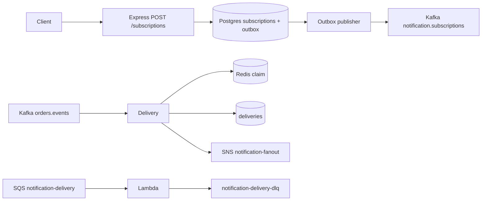
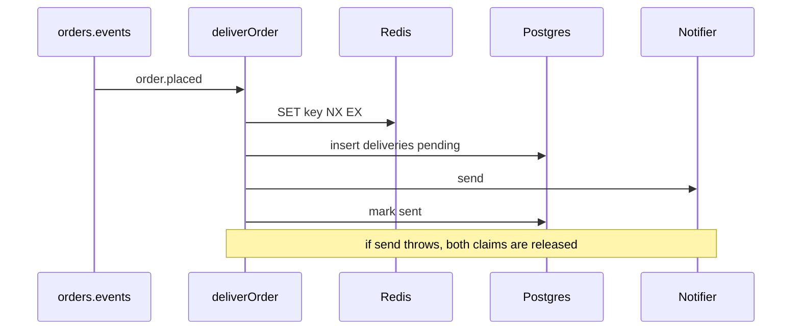

# Event notification platform

A person subscribes to a topic. The subscription and an outbox row are written in one Postgres transaction. A separate consumer reads `orders.events` and sends each `order.placed` once per matching subscription.

The fast duplicate check is Redis `SET NX`. The durable check is a unique `(event_id, subscription_id)` row. The send happens only after both claims. SNS is the delivery port. The local process logs instead of calling AWS.

Kafka in this repo is a broker you run yourself, not Amazon MSK. Express is a normal Node process. Lambda is the SQS worker described in `infra/template.yaml`.

This service does not place orders. It consumes the payload produced by [serverless-order-pipeline](https://github.com/shahriarkhan099/serverless-order-pipeline).

## Flow



## One delivery



## Functional requirements

- Create a subscription with `userId`, `channel`, `address`, and `topic`.
- `channel` is `email` or `sms`. An email address must contain `@`.
- The same user, channel, address, and topic returns the original subscription and does not write a second outbox row.
- `GET /subscriptions?topic=` lists subscriptions for that topic.
- `GET /health` runs `SELECT 1`. A failed check is 503.
- Every new subscription writes one `subscription.created` outbox row in the same transaction.
- The publisher sends unpublished rows to `notification.subscriptions`. The Kafka key is the subscription id.
- A failed send leaves `published_at` null.
- An `orders.events` message is delivered only when it is `order.placed` with a positive integer quantity.
- Each event is sent once per matching subscription. A second delivery of the same event does not send again.
- A failed send releases the Redis key and the pending delivery row, so the retry can send.
- A row already marked `sent` is skipped.
- A per-process limit can skip a subscription before either claim.
- The SQS handler reports a batch item failure when delivery throws.
- After 5 receives the message is failed without calling delivery, matching the queue redrive policy.

## Non-functional requirements

- The subscription and its outbox row commit or roll back together.
- Two creates with the same identity end as one row. The unique index is the race control.
- Redis is the fast path. Postgres is the record. Both have to be claimed before `send`.
- Publishing is at least once. A crash after the broker ack and before the commit republishes the same outbox id.
- A crash after the delivery claim and before `send` leaves the row `pending`. That blocks a retry until the row is released. The failed-send path releases it. A kill between claim and send does not.
- The API does not call Kafka or SNS on the request path.
- No latency SLO is claimed. The tests check correctness, not timing.

## System design

Subscriptions are the write model. The outbox is how that write becomes an event on `notification.subscriptions`.

Delivery is a different path. It does not use the subscription outbox. It reads `orders.events`, finds subscriptions whose topic is `order.placed`, and claims the pair `(event id, subscription id)`. The claim is two steps because Redis can disappear and the unique row cannot. The send runs only after both succeed. If the send throws, both are released and the error propagates so the caller retries.

Express owns the subscription write because the client is waiting on it. The SQS worker is the Lambda-shaped part: parse, deliver or fail the individual record. `infra/template.yaml` names the fanout topic, `notification-delivery`, the dead-letter queue, and `maxReceiveCount: 5`.

## Technologies

- Node.js 22, TypeScript, Express
- PostgreSQL, Prisma
- Redis
- KafkaJS
- AWS Lambda, SQS, SNS, described in SAM
- Docker, GitHub Actions

## Layout

```
src/domain            subscription rules, order event parsing
src/application       create, deliver, rate limit, dead-letter rule
src/infrastructure    Prisma, Redis, Kafka, notifier, resource names
src/interfaces/http   Express
src/interfaces/lambda SQS handler
infra/template.yaml   topic, queues, function
```

## API

```bash
curl -s -X POST http://127.0.0.1:3002/subscriptions \
  -H 'content-type: application/json' \
  -d '{"userId":"u1","channel":"email","address":"a@b.co","topic":"order.placed"}'

curl -s 'http://127.0.0.1:3002/subscriptions?topic=order.placed'
```

A bad body returns 400. `x-request-id` is echoed when the caller sends it.

## How to run

```bash
createdb notifications_test
cp .env.example .env
npm install
npx prisma generate
npx prisma migrate deploy
npm test
npm run dev
```

`npm run dev` listens on `PORT` (default 3002). `npm run publish` sends unpublished subscription events. `OUTBOX_BATCH` defaults to 20. `npm run consume` reads `orders.events` and delivers with the logging notifier. `REDIS_TTL_SECONDS` defaults to 86400.

```bash
docker compose up -d
```

Compose starts Postgres on host port 54330 and Redis on 6379.

## How to test

The tests read `DATABASE_URL` from `.env` and write to that Postgres database. Create it and apply the migrations before the first run:

```bash
createdb notifications_test
cp .env.example .env
npm install
npx prisma generate
npx prisma migrate deploy
```

Typecheck, then run every file in `test/`:

```bash
npm run typecheck
npm test
```

`npm test` runs those files one at a time, because they share `notifications_test`. It fails unless `src` stays at 100% line, branch, and function coverage. The tests do not call AWS. Kafka is a fake producer, and delivery claims use the in-memory store. The Redis client is what `npm run consume` uses.

Run one file the same way:

```bash
node --import tsx --test --test-concurrency=1 test/notifications.test.ts
node --import tsx --test --test-concurrency=1 test/scenarios.test.ts
```

Any other file in `test/` works in that command. `test/notifications.test.ts` needs the database. `test/email.test.ts`, `test/channel.test.ts`, and `test/handler.test.ts` do not.

GitHub Actions runs `npm run typecheck` and `npm test` against Postgres 16. The job is capped at 15 minutes.

## How to deploy

```bash
docker build -t notification-api .
```

The image starts the HTTP API. Run the publisher and the consumer as separate processes (`src/publish-main.ts`, `src/consume-main.ts`) with the same image. The consumer needs `REDIS_URL` and `KAFKA_BROKERS`.

The queue worker:

```bash
sam build --template infra/template.yaml
sam deploy --guided
```

`sam build` bundles `src/interfaces/lambda/entry.ts`. The exported function is `handler`. It delivers with the same `deliverOrder` path as the consumer, and it publishes with `snsNotifier` when `SNS_TOPIC_ARN` is set. The function needs `DATABASE_URL` and `REDIS_URL`. Prisma is left external to the bundle. Tests cover `snsNotifier` with a fake client and `handleDelivery` with a function that throws. They do not call AWS.

## What a failure looks like

| Failure | What the code does |
| --- | --- |
| Empty field, bad channel, email without @ | 400, nothing written |
| Crash inside the subscription transaction | subscription and outbox both gone |
| Same identity inserted twice | one row, one outbox event |
| Broker down during publish | row stays unpublished |
| Send throws | Redis key and pending row are released, error propagates |
| Same event delivered again after success | sent row is skipped |
| Receive count above 5 | message id is a batch failure, delivery is not called |
| Database check fails | `GET /health` returns 503 |
